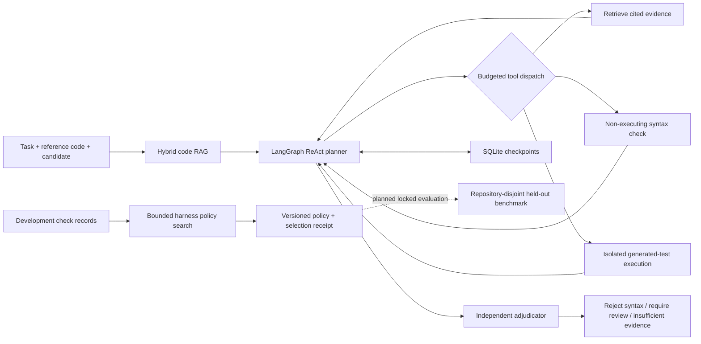

# PatchScope-Agent

Evidence-grounded code verification agents and bounded harness evolution.

CV/display name: **PatchScope-Agent**. The Python package and CLI remain `patchscope`.

**Status: functioning verification prototype with live API/container experiments; no demonstrated RSI improvement.**
The default demo uses a deterministic planner, makes no API calls, and never executes repository code.
The opt-in budgeted API path has been tested with Qwen3-Coder-Flash and digest-pinned Docker execution.
See [API setup](docs/API_SETUP.md) and [raw development comparison](reports/adaptive-comparison.json).
It deliberately returns `insufficient_evidence` for a syntactically valid but semantically wrong patch.

## Motivation

A passing check answers a bounded question: the submitted code passed that particular check.
It does not establish that the check covered the task's intended behavior. Consider a discount
function: `price * percent / 100` parses and even matches the intended formula at a 50% discount,
but fails at other percentages. Repeating the same check adds little evidence about that gap.

PatchScope asks: **given a fixed candidate patch and a verification budget, what should we check
next, and when should we report that the evidence is insufficient?** The intended user is a developer
reviewing an agent-generated patch who needs the evidence behind a decision, including its limits.
The system aims to reduce missed errors without increasing rejection of correct patches; this is an
evaluation objective, not an achieved result.

ReAct provides a way to choose the next inspection from previous observations. Repository RAG
supplies relevant source evidence with citations. LangGraph records the workflow and its state,
while a separate adjudicator prevents a planner's confidence from becoming a correctness verdict.
Harness optimization asks whether recurring development failures can inform reusable check policies
that transfer to unseen repositories. Such policies must beat fixed and equal-budget search baselines;
recursive self-improvement remains a research hypothesis, not a feature established by this prototype.

The key engineering question is whether adaptive verification earns its extra complexity over a
simple fixed checklist. See [the motivation and hypotheses](docs/MOTIVATION.md) and
[the evaluation contract](docs/EVALUATION.md).

## Run locally

```sh
uv sync --extra dev
uv run pytest -q
uv run patchscope review --repo examples/repo --candidate examples/candidate.py \
  --task 'Verify the percentage discount formula and its boundary behavior' \
  --output reports/demo.json
uv run patchscope evolve-demo --records examples/development.json --output reports/evolution-demo.json
```

The input candidate is a **complete Python file replacement**, not a unified diff in this version.
The agent indexes the reference repository and inspects the supplied replacement separately.
Source snapshots, candidate SHA256, line citations, tool observations and graph thread ID appear in JSON.
SQLite checkpoints are local and should be treated as private repository data.

## Architecture



| Technology | Implemented responsibility | Current limit |
|---|---|---|
| ReAct | Action → observation → next action, bounded by runtime | Offline planner is scripted; no LLM performance claim |
| LangChain | Provider adapter + validated structured action output | Budgeted compatible API path verified; other providers untested |
| LangGraph | Conditional control flow and state checkpoints | Persistent state readback tested; crash/retry semantics still to evaluate |
| RAG | Word/character TF-IDF with reciprocal-rank fusion, line citations and hashes | Lexical hybrid, **not dense embedding retrieval**; Python-only |
| Pydantic | Restricted action schema | No arbitrary shell tool |
| SQLite | Durable graph state and evidence | Local single-user prototype |
| Docker | Digest-pinned, read-only, network-disabled execution helper | Integrated and exercised; not a hostile multi-tenant sandbox guarantee |
| Harness evolution | Development-only policy selection, false-rejection gate, baseline fallback | First-order tuning; no recursive self-improvement claim |

## Optional model-driven planner

```sh
uv sync --extra openai
# Set OPENAI_API_KEY in your shell; do not commit it.
uv run patchscope review --repo examples/repo --candidate examples/candidate.py \
  --task 'Inspect discount behavior' --model openai:gpt-4.1-mini
```

This explicitly sends task, candidate and retrieved source text to the selected provider and may incur charges.
Live model experiments use the separately documented budgeted API path. The model can choose tools; it cannot mark a patch correct.

## Why this is not yet RSI

The implemented harness tuner selects check bundles from labeled development records and emits
an auditable receipt. Those example records are hand-authored fixtures, not measurements.
A future improver may propose retrieval policies, test templates and tool order, but promotion must
compare against frozen and equal-budget search baselines on separate data. A recursive-improvement
claim additionally requires an editable improver and measured second-order benefit, not just better prompts.

## Roadmap and evidence gates

1. **Done:** inspectable static ReAct/RAG graph, durable local checkpoints, structured reports,
   bounded development policy selection, offline tests.
2. **Implemented:** isolated JSON test execution and live ReAct tool selection. **Next:** validated
   unified-diff application; generated-test quarantine and stronger output integrity boundaries.
3. **Then:** frozen repository-disjoint benchmark, correct/wrong patch pairs, no-op/static/ReAct/RAG
   ablations, confidence intervals, time/tokens/cost, raw trace replay.
4. **Then:** bounded harness proposer and rollback registry; compare against equal-budget random search.
5. **Implemented:** read-only FastAPI evidence viewer. **Next:** bounded job scheduling after execution/report contracts stabilize.

Do not put accuracy, speedup, false-positive reduction, or RSI gains on a CV until measured.

## References

- [LangGraph persistence](https://docs.langchain.com/oss/python/langgraph/persistence)
- [LangGraph StateGraph API](https://reference.langchain.com/python/langgraph/graph/state/StateGraph)
- [LangChain chat model initialization](https://reference.langchain.com/python/langchain/chat_models/base)

This project is separate from BranchLab's language-model training implementation.

## Live experiment reproduction

```sh
uv run python scripts/fetch_humaneval.py
docker pull python:3.12-slim
# Paid calls, only after configuring .env and confirming the experiment budget:
uv run python scripts/pilot.py
uv run python scripts/compare.py
# Offline report reconstruction:
uv run python scripts/summarize.py
```

Scripts record the resolved image digest. Reproduce a previous run with that exact digest;
the mutable image tag is only a bootstrap convenience. The comparison refuses to overwrite
existing results. Public HumanEval task selection and exclusions are recorded, and generated-test
false rejections are retained. HumanEval is MIT licensed; see `licenses/HumanEval.MIT`.

**Threat boundary:** code runs in a resource-limited, network-disabled container. The current
JSON runner shares a Python process with the candidate; it is designed for non-adversarial
benchmark patches, not malicious candidates that forge output or tamper with the runner.
Do not deploy this prototype as a hostile-code grading service.

## Local evidence dashboard

```sh
uv sync --extra dev --extra web
uv run --extra web python -m patchscope.web --reports reports --port 8766
```

Open http://127.0.0.1:8766. The FastAPI app is bound to loopback and exposes only allowlisted
experiment reports and aggregated cost. It makes no model requests. Each task expands to its
raw test proposals and executions. Refresh explicitly while a run is in progress.

## Findings and promotion decision

Read [the actual findings](docs/RESEARCH_FINDINGS.md), [development report](reports/EXPERIMENT_REPORT.md),
[transfer report](reports/TRANSFER_REPORT.md), and [promotion decision](reports/harness-decision.json).
The adaptive strategy was not promoted. Generated-test failures now produce `review_required`;
the benchmark failures remain recorded. This is an engineering project with an audited negative result,
not a claim of an improved verification algorithm.
